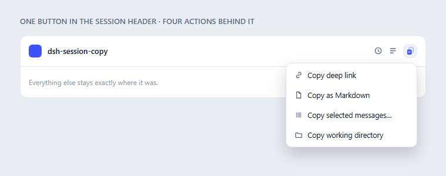
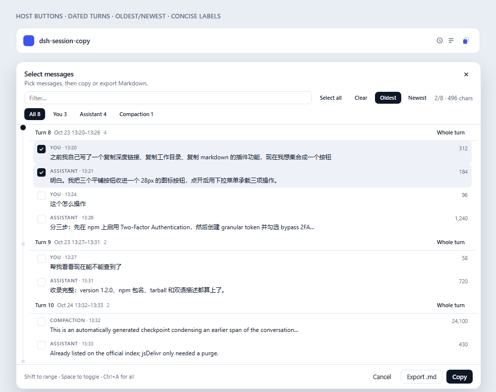

# dsh-session-copy

English | [中文](README.zh.md)

[](https://www.npmjs.com/package/dsh-session-copy)
[](https://www.npmjs.com/package/dsh-session-copy)
[](LICENSE)
[](../../actions/workflows/publish.yml)
[](https://registry.npmjs.org/-/npm/v1/attestations/dsh-session-copy@latest)



One button in the DSH Web session header. Click it and pick what to copy —
**deep link**, **whole conversation as Markdown**, **only the messages you tick**,
or **working directory**. No more row of flat buttons competing with the toolbar.

---

## Why this exists

The session header is a crowded strip of icon buttons, and copying a conversation
out of DSH used to mean three of them. This plugin folds the three into one
28-pixel button whose menu carries the same actions, so the header gains nothing
but a single icon.

The one that actually takes work is **Markdown**. A session log is not a chat
transcript: it is a stream of tool calls, retries, pruned rows, injected context
and — after a while — compaction checkpoints. This plugin reconstructs the
conversation from that stream on the Host side and hands back clean Markdown.

## What you get

| Menu item | What you get |
| --- | --- |
| **Copy deep link** | `@[title](dsh-session:<base64url(session id)>)` — the canonical DSH session mention. Paste it into any composer and the Host attaches that session's snapshot, so another conversation can read this one. |
| **Copy Markdown** | The whole conversation as clean Markdown on the clipboard: one section per message, every assistant step kept, tool output and reasoning folded away, compaction points marked, code fences balanced. |
| **Export Markdown file** | The same document saved as a `.md` file. Use this for anything long — a clipboard write is the part that fails first, and the file has no length cap. |
| **Select messages…** | Opens a timeline picker; tick the messages you want and copy or export only those — the QQ/WeChat multi-select gesture. |
| **Copy directory** | The session's `cwd`, read from the Session list projection with the Host snapshot as fallback. |

Every action reports back in a small notice — including the character count, so
you can tell a 400-character session from a 400,000-character one.

## Why there is a file export

A clipboard write is the weakest link in "copy the whole conversation": browsers
cap or refuse a single write of a few hundred kilobytes, and a silent truncation
looks like the plugin lost your history. Measured on a real 4.3 MB session log:

| | Characters | Complete? |
| --- | --- | --- |
| Clipboard copy (capped) | 212,330 | no — trimmed at the cap |
| File export | 778,435 | yes |

So the clipboard action keeps its cap and says when it trims, while the export
action asks the Host to lift it (8,000,000 characters, still finite so a corrupt
log cannot exhaust memory) and hands you the file. The picker has the same pair
of buttons: **Copy** and **Export .md**.

## Picking only part of a conversation

A long session usually has one stretch worth sharing: the debugging thread, the
decision, the answer. **Select messages…** opens a timeline of every message
with its role, a one-line preview and its size, and copies only what you tick.



- **Timeline.** The list is grouped by turn; each group has a sticky header with
  the turn number, its **calendar date** and time range, and its size, and a rail
  down the left marks every turn — click a marker to jump to it, and the active
  marker follows your scrolling. Every row shows the time its message was sent.
- **Oldest / Newest** switches the whole timeline around, rail included, so you
  can start from the most recent exchange when the part you want is recent. The
  order never changes *which* message a tick refers to.
- **Whole turn** on a header ticks (or clears) every message in that exchange,
  which is usually the unit you actually want.
- **Role chips** — All / You / Assistant / Compaction — cut the list down to the
  side you want; only the roles actually present are offered.
- **Filter** narrows hundreds of rows to the ones you are after. Both the filter
  and the chips scope **Select all**, so "every question I asked about the
  parser" is one chip plus one word.
- **Shift-click** selects a whole range, the way a chat app does, and a range
  never escapes the current filter.
- **Keyboard**: `Space` toggles the focused row, `↑`/`↓`/`Home`/`End` move
  between rows, `Ctrl`/`⌘+A` ticks everything visible, `Escape` closes.
- The meter reads `4 of 7 · 1,832 characters` — both the count and the size of
  what you are about to paste.
- The copied document opens with `> Excerpt: 12 of 340 messages selected`, so a
  pasted fragment is never mistaken for a truncated export.
- The picker lists what the model still holds: compaction checkpoints appear as
  their own rows, so an intentional summary can be included or left out on
  purpose.
- Selecting is local to the dialog — nothing is copied until you press
  **Copy**, and reopening the picker for the same session is instant
  because the list is fetched once.

## Install

### From npm

```sh
dsh plugin add dsh-session-copy
```

### Inside the desktop app

The desktop app has its own plugin manager: open **Settings → Plugins** and
install from there, rather than with the CLI (which targets a different profile
while the app is running). Then restart DeepSeek Harness — the Loader assembles
its plugin list at boot, so a reload of the page is not enough.

### From this checkout

```sh
node scripts/install.mjs --check    # report profile health, change nothing
node scripts/install.mjs            # install or refresh in the current profile
node scripts/install.mjs --uninstall
```

### From a release tarball

The catalog install path, for hosts that would rather not build from source:

```sh
dsh plugin --profile web add \
  https://github.com/2310770803/dsh-session-copy/releases/latest/download/dsh-session-copy.tgz
```

The asset name is deliberately version-free. A `releases/latest/download/` URL
resolves `latest` at request time but takes the filename literally, so a
versioned filename would work until the next release and then quietly 404; the
release workflow re-uploads `dsh-session-copy.tgz` on every tag to keep that URL
stable.

## How the Markdown is built

Three decisions here are the difference between a usable export and a broken one,
and each of them replaced a bug:

**Every assistant step is kept, not just the last one.** A turn is not one reply
— an agentic turn is twenty model steps interleaved with tool calls. Keeping only
the final `assistant/message` of each turn discarded 41% of the assistant text on
a real session (15,717 of 26,657 characters), and lost all 29 intermediate
messages in one turn. All of them are emitted, in order.

**Compaction is marked, not swallowed.** When DSH compacts a conversation it
writes a `compact-checkpoint` message and a `compaction/summary` event, and the
pre-compaction turns stop being what the model sees. Dropping those as "injected
context" makes a long session export with its history silently missing — which
reads as *"the copy is broken"*. They are rendered as an explicit
**Conversation compacted** marker instead, so an intentional summary is never
mistaken for lost content.

**Fences are balanced across the document, not per message.** A message that ends
inside a fenced code block used to get a synthetic closing fence, which left the
*next* message's fences mismatched; one 21 KB export came out with 34 stray fence
markers. Fences are tracked over the assembled document so what you paste renders
as written.

**A selection is trusted only as indices.** The picker sends back the positions it
showed; the Host drops anything out of range, repeated or non-integer rather than
letting it shift the result onto a different message, and reports how many were
discarded. A transcript can then never silently paste someone else's turn.

Reading is also bounded and version-tolerant:

- **The complete history is read, not the model's current view.**
  `sessionQuery.readSession` (the whole raw log) is the source;
  `readSurface` — what the model currently sees — is only the fallback. This
  matters because a compaction *replaces* everything before it: the surface has
  no pre-compaction turns at all. On one real session the surface held 247
  messages across turns 14–22, while the log held 398 across turns 1–22 plus the
  four compaction markers.
- The response is capped at 220,000 characters for a clipboard copy and trimmed
  on a section boundary, because one real session produced a 778 KB document —
  past what a single clipboard write reliably accepts. A file export lifts the
  cap instead (see [Why there is a file export](#why-there-is-a-file-export)).
- Clipboard writes try the Host writer, then the `textarea` + `execCommand` path
  (the one that survives long text and a blurred window), then the async
  Clipboard API, twice. DSH's own bundled writer returns `false` as soon as
  `navigator.clipboard.writeText` throws and never falls back, so delegating to it
  alone was a trap.

## Inside DSH: the plugin market

The repository publishes a single-plugin [plugin market index][index] — the format
DSH's **Plugins → Discover** tab and the `plugin_market` agent tool read:

1. Turn on the market's Discover surface once, in **Settings → Plugins**:
   `@deepseek-ai/dsh-experimental-plugin-market-bundle` ships with DSH, switched
   off.
2. **Plugins → Discover → Index sources →** add
   `https://cdn.jsdelivr.net/gh/2310770803/dsh-session-copy@main/index.json`
3. Search for "session copy" and install.

The index pins an exact commit rather than a branch, so what Discover installs is
reproducible. `node scripts/build-index.mjs` regenerates `index.json` from
`package.json` and `locale/`; `node scripts/check-index.mjs` validates the result
with the host's own parser. The index must name the commit *before* the one that
carries it, which is why the pinned SHA is not the file's own commit.

`node scripts/search-index.mjs` answers the other question — whether a word typed
into Discover actually surfaces the plugin. It runs the host's own search class
over the index, so a pass there means Discover's list narrows to this plugin
rather than merely that the JSON is well-formed:

```sh
node scripts/search-index.mjs --market <dir> --validator <dir>
```

Both `<dir>`s are `@deepseek-ai/dsh-plugin-market` and
`@deepseek-ai/dsh-plugin-market-index` as shipped inside an installed DSH app —
extract them from `resources/app.asar` under `dsh/node_modules/@deepseek-ai/`.

The plugin is also listed in the [awesome-dsh-plugin][awesome] catalog, whose
entry is one YAML file in that repository,
`data/plugins/2310770803__dsh-session-copy.yml`.

## Supply chain

Releases are built by GitHub Actions and published with npm's **trusted
publishing**: the workflow authenticates with a short-lived OIDC token, and no
long-lived npm token exists in this repository. Every release carries a
[SLSA provenance statement](https://registry.npmjs.org/-/npm/v1/attestations/dsh-session-copy@latest),
so the tarball on npm can be traced back to the commit and workflow that built
it. Publishing is idempotent — re-running a release for an already-published
version is a no-op, not an error.

## Compatibility

| | |
| --- | --- |
| Host | DSH `0.2.1-rc.2` and newer (`@deepseek-ai/dsh-*` peers are pinned to the prerelease branches) |
| Surface | DSH Web and the desktop app's Web view |
| Permissions | none — the Host route is read-only and same-origin fenced |

Everything is feature-detected against the shared client module table. If a future
DSH release drops the `Menu` primitive, the same three actions render in a
self-contained popover instead of degrading into a row of flat buttons; if it
renames a service, the affected piece degrades rather than raising inside the boot
activation audit.

## Display metadata

The Settings → Plugins card reads this package's metadata **without evaluating**
`lib/client.js`:

- `locale/en.json` and `locale/zh.json` — `meta.title` / `meta.description`;
- `package.json` `name` / `description` as the fallback;
- `package.json` `icon` (`./icon.svg`) for the card artwork.

## Layout

| Path | Role |
| --- | --- |
| `src/plugin.js` | Host half: registers the read-only snapshot route on `webServer`. |
| `src/lib/route.js` | The `/api/session-copy.snapshot` handler, its trust fence and body limits. |
| `src/lib/markdown.js` | Session events → Markdown rendering. |
| `lib/client.js` | Browser half, shipped prebuilt in the loader's closure-factory format. |
| `cordis.patch.yml` | Inserts the `session-copy` row into the Web profile. |
| `locale/`, `icon.svg` | Plugin-list title, description and artwork. |

## License

[MIT](LICENSE)

[index]: https://cdn.jsdelivr.net/gh/2310770803/dsh-session-copy@main/index.json
[awesome]: https://github.com/awesome-dsh-plugin/awesome-dsh-plugin
