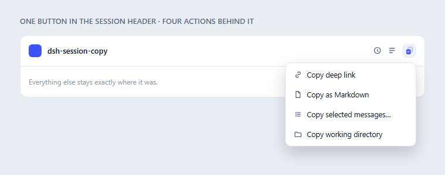
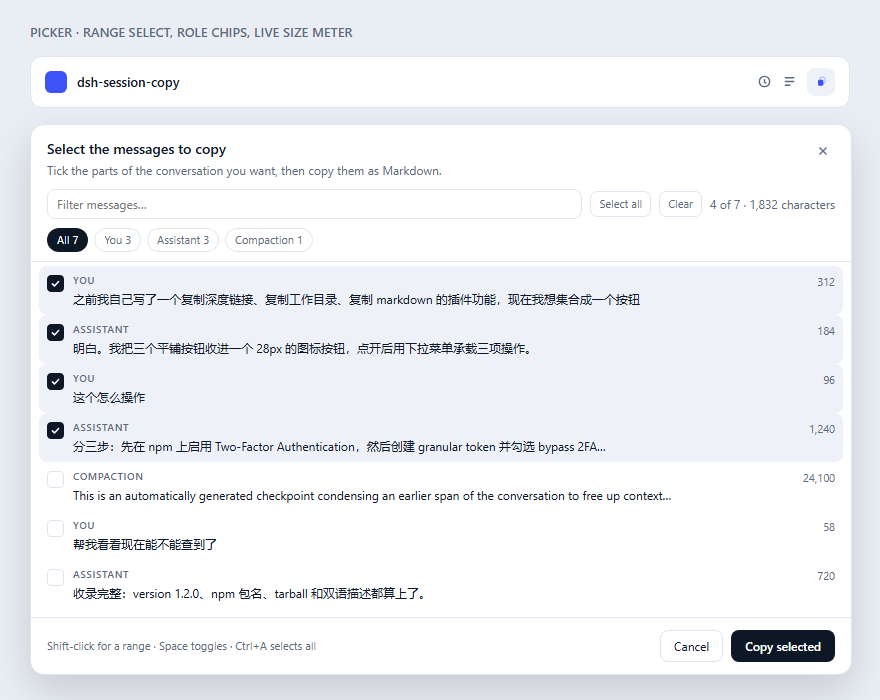

# dsh-session-copy

[English](README.md) | 中文

[](https://www.npmjs.com/package/dsh-session-copy)
[](https://www.npmjs.com/package/dsh-session-copy)
[](LICENSE)
[](../../actions/workflows/publish.yml)
[](https://registry.npmjs.org/-/npm/v1/attestations/dsh-session-copy@latest)



DSH Web 会话标题栏里的**一个**按钮。点开它，自己选要复制什么：**深度链接**、**整段对话 Markdown**、**只复制勾选的消息**，或**工作目录**。标题栏于是不再有一排平铺按钮和工具栏抢位置。

---

## 为什么做它

会话标题栏是一整条拥挤的图标区，而把一次对话复制出来原本要占掉其中三个位置。这个插件把三件事收进一个 28px 的按钮，菜单里还是那几项操作——标题栏除了一个图标之外什么都没多。

真正费功夫的是**复制 Markdown**。会话日志并不是聊天记录，而是一条混杂着工具调用、重试、被裁掉的行、注入上下文，以及跑久了之后出现的压缩检查点的事件流。这个插件在宿主侧把对话从这条流里重建出来，交回干净的 Markdown。

## 你会得到什么

| 菜单项 | 你得到什么 |
| --- | --- |
| **复制深度链接** | `@[标题](dsh-session:<base64url(会话 id)>)`，即标准 DSH 会话提及。粘到任何输入框里，宿主就会把该会话的快照带进来，其他对话因此可以引读本次会话。 |
| **复制 Markdown** | 整段对话渲染成干净 Markdown 写进剪贴板：每条消息一节，保留每一步助手回复，工具输出与思考过程折叠掉，压缩位置明确标注，代码围栏成对闭合。 |
| **导出 Markdown 文件** | 同一份文档存成 `.md` 文件。**长内容请走这一项**——先撑不住的是剪贴板，文件没有长度上限。 |
| **选择消息…** | 打开时间线面板，勾选哪几条就只复制／导出哪几条——就是 QQ/微信多选聊天记录那个手势。 |
| **复制工作目录** | 该会话的 `cwd`，取自会话列表投影，缺失时回落到宿主快照。 |

每次操作都会回一条小提示，并带上字符数，让你知道这是一段 400 字还是 40 万字。

## 为什么需要「导出文件」

在「复制整段对话」这件事上，最脆弱的一环是**剪贴板**：浏览器对单次写入几百 KB 会截断或拒绝，而被悄悄截断的结果看起来就像插件弄丢了你的历史。在一个真实的 4.3MB 会话日志上实测：

| | 字符数 | 是否完整 |
| --- | --- | --- |
| 复制（受上限约束） | 212,330 | 否，在上限处截断 |
| 导出文件 | 778,435 | 是 |

所以「复制」保留上限、并在截断时明确告知；「导出」让宿主放开上限（8,000,000 字符，仍然有限，避免损坏日志把内存吃满）后把文件交给你。选择面板里同样是这一对按钮：**复制所选** 与 **导出所选为文件**。

## 只复制对话的一部分

一次长会话通常只有一小段值得分享：那次排查、那个决定、那句答案。**选择消息…** 会列出每一条消息的角色、一行预览和字数，勾选哪几条就只复制或导出哪几条。



- **时间线**：列表按轮次分组，每组标题吸顶并带轮次号、时间范围和条数；左侧一条时间轴给每一轮一个标记，点一下跳到那一轮，当前标记会跟着滚动位置高亮。每条消息都显示发送时间。
- 标题上的**整轮**按钮一键勾选（或取消）这一轮的全部消息——通常这才是你真正想选的单位。
- **角色筛选**（全部／你／助手／压缩点）把列表切到你要的那一侧，只列出实际存在的角色。
- **筛选框**把几百行收窄到你找的那几条；筛选和角色**共同作用**于「全选」，所以「所有我问过的、和解析器有关的」等于一个角色加一个词。
- **Shift 点选**可以整段连选，和聊天软件一样；连选范围不会越出当前筛选。
- **键盘**：`空格` 勾选当前行，`↑`/`↓`/`Home`/`End` 在行间移动，`Ctrl`/`⌘+A` 全选可见项，`Esc` 关闭。
- 计数显示成 `已选 4 / 7 · 1,832 字符`——既告诉你选了几条，也告诉你即将粘贴多大。
- 复制出的文档开头会写明 `> Excerpt: 12 of 340 messages selected`，粘出去的片段因此不会被误当成被截断的整篇导出。
- 列表列的是模型当前仍持有的内容：压缩检查点会单独成为一行，要不要带上它由你决定。
- 勾选只发生在面板里——不点「复制所选」什么都不会写进剪贴板；同一会话再次打开面板是瞬时的，列表只取一次。

## 安装

### 从 npm 安装

```sh
dsh plugin add dsh-session-copy
```

### 在桌面版内部安装

桌面版有自己的插件管理器：请在 **设置 → 插件** 里安装，而不是用命令行（应用运行时 CLI 指向的是另一个 profile）。装完请**重启 DeepSeek Harness**——Loader 在启动时组装插件列表，刷新页面不够。

### 从这个源码目录安装

```sh
node scripts/install.mjs --check    # 只体检，不改动
node scripts/install.mjs            # 安装或刷新到当前 profile
node scripts/install.mjs --uninstall
```

### 从发行版 tarball 安装

适合不想从源码构建的宿主，也就是插件目录用的那条路径：

```sh
dsh plugin --profile web add \
  https://github.com/2310770803/dsh-session-copy/releases/latest/download/dsh-session-copy.tgz
```

资产名刻意不带版本号：`releases/latest/download/` 只在请求时解析 `latest`，文件名是照字面取的，所以带版本号的名字在下次发版后就会静默 404。发布流程会在每个 tag 上重传 `dsh-session-copy.tgz`，让这个链接始终有效。

## Markdown 是怎么生成的

下面三个决定，就是「能用」和「坏了」的分界线，每一个都替换掉了一个真实的 bug：

**保留每一步助手回复，而不是只留最后一条。** 一个回合不是一条回复——一个 agentic 回合是二十个模型步骤夹着工具调用。只保留每回合最后一条 `assistant/message`，在真实会话上丢掉了 41% 的助手正文（26,657 字里只留 15,717 字），某个回合的 29 条中间消息更是全部消失。现在按顺序全部输出。

**压缩是被标注，而不是被吞掉。** DSH 压缩会话时会写一条 `compact-checkpoint` 消息和一个 `compaction/summary` 事件，而压缩前的回合不再属于模型可见内容。把它们当作「注入上下文」丢掉，会让长会话导出时历史凭空缺失——读起来就是「复制坏了」。它们现在渲染成显式的**会话已压缩**标记，于是有意的摘要永远不会被误当成丢失的内容。

**代码围栏在整篇文档上配平，而不是逐条消息。** 一条消息若在围栏内结尾，过去会被补一个闭合围栏，结果下一条消息的围栏就全错位了；有一份 21KB 的导出因此出现 34 个游离的围栏标记。现在围栏按整篇文档追踪，粘出去的内容渲染出来是什么样，写下来就是什么样。

**选择只被当作下标信任。** 面板把展示过的位置回传给宿主；越界、重复、非整数的下标一律丢弃（而不是让后面的项整体前移、结果落到另一条消息上），并回报丢了几项。这样一次复制永远不可能在无人察觉时粘到别人的那一轮对话。

读取同样有边界、也不跟版本绑死：

- 优先用 `sessionQuery.readSurface`（**当前模型可见面**），而不是 `readSession`（含被 `compaction/prune` 遮蔽行的完整原始日志）；可见面无法折叠时回落到 `readSession`。
- 响应上限 220,000 字符，按小节边界截断——因为真实会话里出现过 434KB 的文档，超出了单次剪贴板写入可靠接受的范围。
- 剪贴板写入依次尝试宿主写入器、`textarea`+`execCommand`（长文本和窗口失焦时唯一可靠的那条）、异步 Clipboard API，并整体重试两轮。DSH 自带的写入器一旦 `navigator.clipboard.writeText` 抛错就直接返回 `false` 且不降级，只委托给它是个陷阱。

## 在 DSH 里：插件市场

仓库发布了一份单插件[插件市场索引][index]——就是 DSH **插件 → 发现** 与 `plugin_market` 工具读取的格式：

1. 先在「设置 → 插件」里打开市场所需的 `@deepseek-ai/dsh-experimental-plugin-market-bundle`（DSH 自带，默认关闭）；
2. **插件 → 发现 → 索引源** 添加
   `https://cdn.jsdelivr.net/gh/2310770803/dsh-session-copy@main/index.json`；
3. 搜「session copy」即可安装。

索引固定的是具体 commit 而不是分支，所以装下来的版本可复现。`node scripts/build-index.mjs` 依据 `package.json` 与 `locale/` 重新生成 `index.json`，`node scripts/check-index.mjs` 用宿主自己的解析器校验结果；索引指向的必须是它前面那个 commit，因此锁定的 SHA 不会等于该文件自身的提交。

`node scripts/search-index.mjs` 回答的是另一个问题——在「发现」里输入一个词，到底能不能搜出这个插件。它跑的是宿主自己的搜索类，所以通过意味着「发现」的列表真的会收敛到这个插件，而不只是 JSON 格式合法：

```sh
node scripts/search-index.mjs --market <dir> --validator <dir>
```

两个 `<dir>` 分别是已安装 DSH 里的 `@deepseek-ai/dsh-plugin-market` 与 `@deepseek-ai/dsh-plugin-market-index`，可从 `resources/app.asar` 的 `dsh/node_modules/@deepseek-ai/` 下解出。

插件同时收录在 [awesome-dsh-plugin][awesome] 目录中，条目就是该仓库里的一个 YAML 文件：`data/plugins/2310770803__dsh-session-copy.yml`。

## 供应链

版本由 GitHub Actions 构建，并以 npm 的**信任发布（trusted publishing）**发布：工作流用短时有效的 OIDC 令牌认证，仓库里不存在任何长期 npm token。每个版本都附带 [SLSA provenance 证明](https://registry.npmjs.org/-/npm/v1/attestations/dsh-session-copy@latest)，npm 上的 tarball 可追溯到构建它的 commit 与 workflow。发布是幂等的——对已发布的版本重跑发布只会跳过，不会报错。

## 兼容性

| | |
| --- | --- |
| 宿主 | DSH `0.2.1-rc.2` 及更新版本（`@deepseek-ai/dsh-*` 对等依赖锁定在预发布分支上） |
| 界面 | DSH Web 与桌面版的 Web 视图 |
| 权限 | 无——宿主路由只读，且限定同源访问 |

所有能力都做了特性探测。若将来 DSH 去掉共享的 `Menu` 原语，三个操作会改用自绘弹层，而不会退化成三个平铺按钮；若某个服务改名，受影响的部分会降级，而不是在启动激活审计里抛错。

## 显示元数据

「设置 → 插件」里的卡片**不加载客户端代码**就能读出本包的元数据：

- `locale/en.json` 与 `locale/zh.json` — `meta.title` / `meta.description`；
- 缺失时回落到 `package.json` 的 `name` / `description`；
- 卡片图标来自 `package.json` 的 `icon`（`./icon.svg`）。

## 目录结构

| 路径 | 作用 |
| --- | --- |
| `src/plugin.js` | 宿主半边：在 `webServer` 上注册只读快照路由。 |
| `src/lib/route.js` | `/api/session-copy.snapshot` 处理器、同源校验与体积限制。 |
| `src/lib/markdown.js` | 会话事件 → Markdown 渲染。 |
| `lib/client.js` | 浏览器半边，以 loader 的闭包工厂格式预构建发布。 |
| `cordis.patch.yml` | 把 `session-copy` 这一行插进 Web profile。 |
| `locale/`、`icon.svg` | 插件列表里的标题、说明与图标。 |

## 许可

[MIT](LICENSE)

[index]: https://cdn.jsdelivr.net/gh/2310770803/dsh-session-copy@main/index.json
[awesome]: https://github.com/awesome-dsh-plugin/awesome-dsh-plugin
